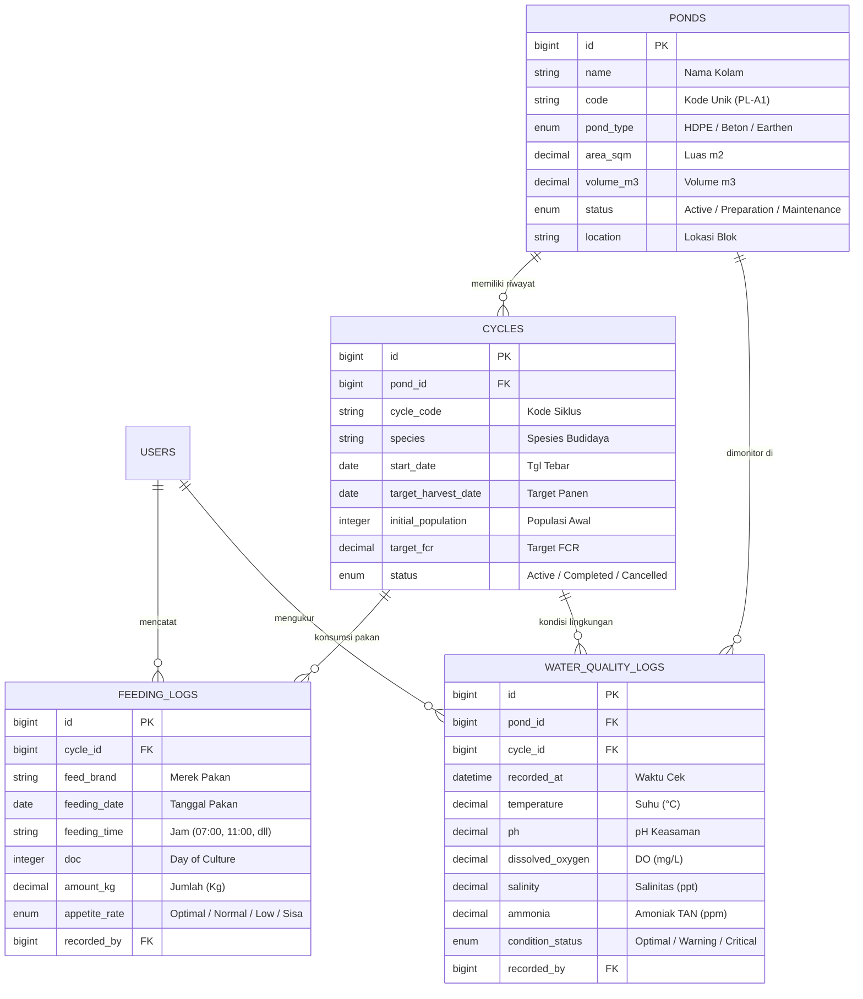

# 🌊 NagroSmart • Smart Aquaculture Management Platform

[](https://laravel.com)
[](https://filamentphp.com)
[](https://php.net)
[](#automated-testing)
[](https://laravel.com/docs/11.x/sanctum)

> **High-Performance Aquaculture & IoT-Ready Farm Operations Backend**  
> Didesain khusus untuk operasional tambak intensif udang & ikan (Vaname, Windu, Nila Salin), mencakup manajemen siklus budidaya (*cycles*), monitoring berkala parameter kualitas air (*water quality logs*), pencatatan pakan harian (*feeding logs*), dan integrasi RESTful API untuk aplikasi mobile (Flutter).

---

## 📌 Latar Belakang & Problem Statement

Dalam industri budidaya tambak modern (*smart aquaculture*), **keterlambatan deteksi penurunan kualitas air (terutama *Dissolved Oxygen* / DO)** atau **kesalahan takaran pakan harian** dapat mengakibatkan kematian massal biota dan pembengkakan nilai FCR (*Feed Conversion Ratio*).

Platform ini hadir sebagai solusi backend terpusat yang:
1. **Memvalidasi dan mengklasifikasikan kondisi air secara real-time** (*Optimal*, *Warning*, *Critical*) berdasarkan batas aman biologis DO, pH, amoniak, dan salinitas.
2. **Menyederhanakan pengawasan Day of Culture (DOC)** secara dinamis mulai dari tebar benih hingga panen.
3. **Menyediakan RESTful API terstandarisasi** untuk input data cepat oleh teknisi lapangan via aplikasi mobile (Flutter) di lokasi tambak dengan sinyal terbatas.
4. **Menyediakan Admin Panel elegan berbasis Filament v3** untuk dashboard analitik bagi *farm manager* dan *farm owner*.

---

## 🏛️ Arsitektur Relasi Database (ERD)



---

## 🚀 Fitur Utama

- **Filament v3 Admin Panel (`/admin`)**:
  - **KPI Metrics Dashboard**: Kolam operasional, siklus aktif, total pakan 30 hari terakhir, rata-rata DO real-time.
  - **Interactive Chart Widget**: Grafik tren parameter kualitas air (DO, pH, Suhu) selama 7 hari.
  - **Color-coded Status Badges**: Evaluasi visual seketika untuk kolam kritis atau sisa pakan tinggi.
  - **Filter & Search Dinamis**: Filter berdasarkan blok kolam, spesies, atau status air.
- **RESTful API untuk Mobile Client (Flutter Ready)**:
  - Token-based Bearer Authentication via Laravel Sanctum.
  - Endpoint ringkasan pakan & analitik siklus budidaya (*DOC harian, total kg pakan*).
  - Endpoint `water-quality-logs/latest` untuk widget status real-time di aplikasi mobile petugas.
- **Database Seeder Realistis**:
  - 5 Kolam tambak dengan spesifikasi teknis lengkap (HDPE, beton, tandon).
  - 4 Siklus budidaya aktif (Udang Vaname, Windu, Nila Salin).
  - 480 Catatan pakan selama 30 hari terakhir (4 jadwal harian dengan tren kenaikan pakan sesuai DOC).
  - 300 Catatan sensor kualitas air pagi & sore selama 30 hari terakhir.
- **Automated Feature Test Suite**:
  - Test login, validasi payload, hak akses API, filter data, dan konsistensi relasi Eloquent.

---

## 🔐 Kredensial Demo Akun

| Peran (Role) | Email | Password | Hak Akses |
| :--- | :--- | :--- | :--- |
| **Farm Admin** | `admin@aquafarm.test` | `password` | Akses Dashboard Filament & API |
| **Field Technician** | `teknisi@aquafarm.test` | `password` | Akses Pencatatan Lapangan & API |

---

## 🛠️ Instalasi & Menjalankan di Lokal

### Prasyarat
- PHP >= 8.2
- Composer 2.x
- SQLite (bawaan PHP) atau MySQL

### Langkah Cepat (3 Menit)

1. **Clone repositori dan masuk ke direktori**:
   ```bash
   git clone <URL_REPO_ANDA>
   cd aquaculture-laravel-api
   ```

2. **Instal dependensi Composer**:
   ```bash
   composer install
   ```

3. **Setup environment & generate app key**:
   ```bash
   cp .env.example .env
   php artisan key:generate
   ```

4. **Jalankan migrasi database beserta data dummy seeder**:
   ```bash
   php artisan migrate --seed
   ```

5. **Jalankan web server lokal**:
   ```bash
   php artisan serve
   ```

Buka di browser:
- **Landing Portal**: `http://127.0.0.1:8000`
- **Filament Admin Panel**: `http://127.0.0.1:8000/admin`
- **API Healthcheck**: `http://127.0.0.1:8000/api/health`

---

## 🧪 Automated Testing

Proyek ini telah dilengkapi dengan suite pengujian otomatis fitur API:

```bash
php artisan test --filter=AquacultureApiTest
```

Output:
```text
   PASS  Tests\Feature\AquacultureApiTest
  ✓ healthcheck returns ok                                               0.37s  
  ✓ user can login via api                                               0.17s  
  ✓ user cannot login with invalid credentials                           0.14s  
  ✓ authenticated user can get profile                                   0.14s  
  ✓ can list ponds                                                       0.15s  
  ✓ can create new pond                                                  0.14s  
  ✓ can get cycle summary                                                0.13s  
  ✓ can fetch latest water quality for active ponds                      0.14s  

  Tests:    8 passed (74 assertions)
```

---

## 📖 Dokumentasi Endpoint REST API

Semua endpoint yang terproteksi membutuhkan Header:  
`Authorization: Bearer <token_dari_login>` dan `Accept: application/json`.

| Method | Endpoint | Auth | Deskripsi |
| :--- | :--- | :---: | :--- |
| `POST` | `/api/v1/auth/login` | Publik | Otentikasi user & mengembalikan Bearer Token |
| `GET` | `/api/v1/auth/me` | Bearer | Informasi profil user yang sedang login |
| `POST` | `/api/v1/auth/logout` | Bearer | Mencabut token aktif saat ini |
| `GET` | `/api/v1/ponds` | Bearer | Mengambil daftar semua kolam tambak |
| `GET` | `/api/v1/ponds/{id}` | Bearer | Detail kolam lengkap dengan siklus aktif & air terakhir |
| `POST` | `/api/v1/ponds` | Bearer | Menambahkan kolam baru |
| `GET` | `/api/v1/cycles` | Bearer | Daftar siklus budidaya (bisa filter `?status=active`) |
| `GET` | `/api/v1/cycles/{id}/summary` | Bearer | Ringkasan analitik siklus (DOC, total pakan, rerata DO) |
| `GET` | `/api/v1/feeding-logs` | Bearer | Riwayat log pakan (filter `?cycle_id=&date=`) |
| `POST` | `/api/v1/feeding-logs` | Bearer | Mencatat sesi pemberian pakan baru |
| `GET` | `/api/v1/feeding-logs/summary` | Bearer | Agregasi pakan harian 7/30 hari terakhir |
| `GET` | `/api/v1/water-quality-logs` | Bearer | Riwayat parameter air terpaginasi |
| `POST` | `/api/v1/water-quality-logs` | Bearer | Mencatat hasil tes sensor air (auto evaluate status) |
| `GET` | `/api/v1/water-quality-logs/latest` | Bearer | Data kualitas air mutakhir seluruh kolam aktif |

> 📁 File Postman Collection siap pakai tersedia di: [`docs/postman_collection.json`](docs/postman_collection.json).

---

## 🚢 Panduan Deploy Live (Docker / Railway / Fly.io / Render)

Proyek ini telah dilengkapi dengan `Dockerfile` siap pakai berbasis Alpine Linux ringan dengan SQLite yang otomatis ter-migrasi dan ter-seed saat container menyala:

```bash
docker build -t aquaculture-backend .
docker run -p 8000:8000 aquaculture-backend
```

Untuk deploy di layanan cloud gratis / PaaS (seperti **Railway** atau **Render**):
1. Hubungkan repo GitHub ini.
2. Pilih opsi deployment via **Dockerfile**.
3. Tetapkan Environment Variable `APP_ENV=production` dan `APP_DEBUG=false`.
4. Aplikasi akan langsung aktif dan live!

---

## 👨‍💻 Profil Pengembang

- **Nama**: Mochamad Aziz Noviyanto
- **Fokus**: Backend & Full-Stack Laravel / Flutter Mobile Engineer
- **GitHub**: [@mochamad-aziz-nuv](https://github.com/mochamad-aziz-nuv)
